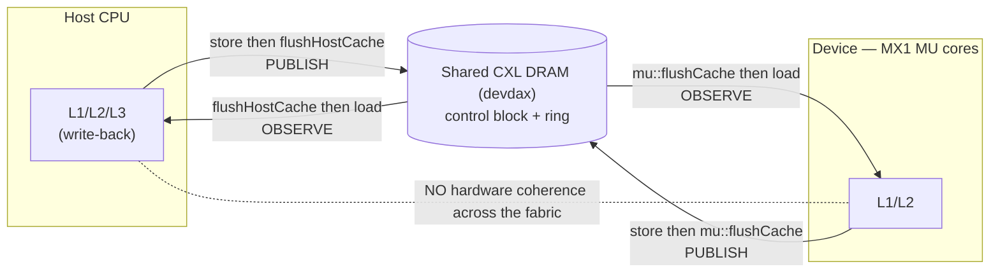

# Persistent device kernel — feasibility spike

Can a kernel stay **resident** on the XCENA MX1 device cores and pull work the
host enqueues into a shared CXL queue *after* launch — paying host-side dispatch
cost **once** instead of per task? This is the linchpin for porting a
fine-grained task runtime (mxtasking) onto the device: it only works if the
scheduler runs on the device, not if every task round-trips through the host
(where dispatch fixed cost is ~3.3 ms — see the orchestration-tax results).

Binary: `main_spike.cpp` (host driver) + `mu_kernel/persistent_puller.cpp`
(device kernel). Shared control+ring buffer in device DRAM (`memAlloc`, devdax),
64B-separated control fields. Must run as root (host load/store to device
memory SIGBUSes otherwise).

Three questions:
- **Q1 residency** — does a kernel run unbounded, or is it watchdog-killed?
- **Q2 visibility** — does a running kernel see host enqueues without relaunch?
- **Q3 doorbell** — does device→host `asyncMessage` reach a host callback?

---

## Headline

**The data plane is feasible today.** A resident device loop sees host-enqueued
work in shared CXL memory, maintains two-way coherence, and signals the host —
all with plain-pointer access + the public `flushCache` (no exotic cache
intrinsics needed). Measured (2026-07-14, MX1 in devdax):

| Check | Result | Evidence |
|-------|--------|----------|
| Q2 host→device visibility | **PASS** | `PROC` tracked `TAIL` exactly: 40→80→120→160→200 |
| Q1 residency | **PASS** | `HB` rose monotonically the **whole 60 s idle** (48.4M iters), no watchdog kill; rate rock-steady at ~806k iters/s (±0.005%) |
| two-way coherence | **PASS** | echo proof 200/200 (device wrote `payload+1`, host read it back) |
| host→device control | **PASS** | kernel exited on the host-set `STOP` flag |
| Q3 device→host doorbell | **PASS** | `asyncMessage` 200/200 delivered to host `setMessageCallback` |
| Throughput | **~24 ns/task** | single-poller drain: 23.5 ns/task @1M, 24.3 ns/task @10M (~42 M tasks/s), checksum-verified |

> The doorbell result resolves an open concern from the SDBI design review
> ("no device→host signal found in the SDK"): `asyncMessage` +
> `map->setMessageCallback` is that path, and it works (messages are serviced
> on the host during `synchronize()`).

---

## The one gap: non-blocking launch

The dedicated **non-blocking kernel** primitive
(`MU_NON_BLOCKING_KERNEL_INIT`, `__mu_kernel_type__=1`) launched via
`map->execute()` **never starts** — every coredump decodes to **PC = 0x0** on
all threads (device never entered the kernel). This held across four variants
(`readGlobal` and plain-pointer access, with/without `hostPrintf` and the L2
invalidate externs), so it is the *launch path*, not the kernel body. There is
no separate non-blocking launch API in the pxl host headers — `execute()` is
the only entry point.

**Open question for XCENA:** how is a `__mu_kernel_type__=1` kernel meant to be
started, given `execute()` leaves PC at 0?

**Blocking vs non-blocking — what the type means.** Not about the host
`execute()` call (a ~0.1 ms doorbell either way; the wait is in `synchronize()`)
but the device-side *lifecycle contract*:
- **blocking** (`MU_KERNEL_ADD`, type 0): run-to-completion job. Runtime tracks
  `launch→start→end→terminate`, `synchronize()` waits for "done", the kernel
  holds its sub for its whole life. All benchmark kernels + our v5 spike.
- **non-blocking** (`__mu_kernel_type__=1`): detached / fire-and-forget — no
  blocking completion handshake, kernel runs on its own. The natural form for a
  persistent resident scheduler the host doesn't wait on.

So with the blocking kernel we keep it resident by **parking one host thread in
`synchronize()`** for the kernel's life — a long-running job with a babysitter
thread, not a true daemon. Non-blocking would drop the babysitter. (The
non-blocking description is inferred from the macro/SDK header — type=1 never
executed, so its exact residency/completion contract is unconfirmed.)

**Workaround (used to get the results above):** a **normal blocking kernel**
(`MU_KERNEL_ADD`) spinning in a bounded loop, launched via
`execute()` + `synchronize()`, while a **separate host thread** enqueues and
reads results. One host thread is parked in `synchronize()` for the kernel's
lifetime, but other host threads interact freely — functionally equivalent to a
resident puller. The loop is bounded three ways (host `STOP`, iteration cap,
and a `getClockCycle` budget) so a blocking kernel can never hang
`synchronize()`.

---

## Coherence model

### The setup

The shared queue lives in **device CXL DRAM** (devdax). Both sides cache lines
of it — the host CPU in its normal write-back L1/L2/L3, the device MU cores in
their L1/L2. Crucially, **there is no hardware coherence spanning the
host↔device boundary**: a write by one side sits in that side's cache and is
invisible to the other until it is explicitly pushed to DRAM *and* the other
side's stale copy is dropped.

This is precisely the gap CXL 3.0 back-invalidate closes in hardware. This
device doesn't have it, so we do it in software — which makes the spike a
working micro-instance of the SDBI premise.



### The rule

Two operations, applied by hand:

- **Publish** (writer → DRAM): after storing, **flush** so the dirty line is
  written back.
- **Observe** (reader ← DRAM): before loading, **invalidate** the cached copy so
  the load misses and re-fetches.

On this hardware "flush" is really **flush-and-invalidate** (write back if
dirty, then drop the line), so the *same* call serves both roles — after a write
it publishes; before a read it drops any stale copy. That's why the same
primitive brackets every cross-boundary access, on both sides:

```
device → host:  device: *ptr = v;  mu::flushCache(ptr, 8);       // publish
                host:   pxl::flushHostCache(ptr, 8); read *ptr;  // observe

host → device:  host:   *ptr = v;  pxl::flushHostCache(ptr, 8);  // publish
                device: mu::flushCache(ptr, 8);      read *ptr;  // observe
```

### Ordering discipline (the subtle part)

Data must reach DRAM **before** the flag that announces it, or the consumer sees
"ready" and then reads stale data. Producer publishes data first, flag last;
consumer reads flag first, then data. This is **release/acquire semantics with
explicit flushes as the fences**.

```mermaid
sequenceDiagram
    participant H as Host (producer)
    participant M as CXL DRAM
    participant D as Device (consumer)
    Note over H,D: RELEASE — data before flag
    H->>M: write payloads
    H->>M: flushHostCache(payloads)  ← data lands first
    H->>M: write TAIL (flag)
    H->>M: flushHostCache(TAIL)      ← flag published last
    Note over H,D: ACQUIRE — flag before data
    D->>M: mu::flushCache(TAIL)      ← drop stale
    M-->>D: load TAIL (fresh) — advanced?
    D->>M: mu::flushCache(payload)
    M-->>D: load payload (fresh)
    Note over H,D: completion travels back the same way
    D->>M: process; write HEAD/PROC + mu::flushCache
    M-->>H: flushHostCache + load HEAD/PROC (fresh)
```

### False sharing — why the 64 B spacing

Flush/invalidate works at **cache-line (64 B) granularity**, not per word. If a
host-written field (`TAIL`) shared a line with a device-written field (`HB`), the
device flushing `HB` would write back the *whole line* — including a stale
`TAIL` — stomping the host's fresh value (and vice versa). So every control
field sits on its own 64 B line (`HEAD=0, TAIL=8, STOP=16, PROC=24, HB=32…`,
8 longs = 64 B apart). Host-written and device-written fields never share a
line. **This is a correctness requirement, not a micro-optimization.**

### What we didn't need

libmu exposes finer intrinsics — `mu::cache::l2_cache::invalidPoolHostData()` /
`flushPoolHostData()`, reflecting separate **host-data** and **mu-data** L2 pools
(the hardware's own notion of "lines from the host" vs "my lines"). Per-address
`flushCache` alone proved sufficient: plain pointer access + flush gave correct
bidirectional coherence with no drift over tens of millions of iterations. The
pool intrinsics would be an *optimization* (invalidate the whole host pool once
instead of per line), not a correctness requirement.

### Evidence it holds

- **Echo proof** — device read a host-written payload, wrote `payload+1` back,
  host read it correctly, 200/200. Exercises both directions in one round trip.
- **`PROC` tracking `TAIL`** — device observed every host enqueue, host observed
  every completion, across 60 s and millions of iterations, no drift.
- **`STOP` propagation** — host set a flag, device saw it and exited.

**In one sentence:** shared CXL DRAM with no hardware cross-boundary coherence;
correctness comes from an explicit release/acquire discipline — writer flushes to
publish, reader invalidates to observe — over cache-line-isolated fields. That is
exactly the software-managed coherence SDBI is built on, and it is both correct
and cheap (the ~24 ns/task pull cost *includes* these flushes).

---

## What worked, concretely

- **Memory access:** plain `*(volatile long*)ptr` loads/stores to the `memAlloc`
  buffer + `flushCache` (see *Coherence model* above). The
  `readGlobal`/`writeGlobal` intrinsics were a dead end — they target the
  on-chip global cache, a different address space, and faulted.
- **Residency:** held a full **60 s** with the heartbeat rising monotonically at
  a rock-steady ~806k iters/s (±0.005% across twelve 5 s samples), no watchdog,
  no drift. `PROC` stayed flat during idle (no spurious work) and a post-idle
  enqueue was still consumed → the loop stays *functional*, not just alive. The
  constant rate makes indefinite residency near-certain.
- **Poll rate:** ~806k loop iterations/s (each doing several flush + load/store
  ops). This is the ceiling on task-pull throughput and the next thing to
  measure against real per-task host dispatch.
- **Launch latency:** `execute()` returns in ~0.1 ms (non-blocking doorbell
  semantics confirmed even for the blocking kernel — the wait is in
  `synchronize()`).

---

## Throughput (drain_bench)

Host pre-writes N task descriptors into device DRAM at unique sequential
addresses (each read fresh — the realistic case for a task queue); the device
drains all N while timing **itself** with `getClockCycle` (MU = 1 GHz, so
cycles = ns), giving the pure per-task pull cost independent of host production.
Checksum (Σ payloads) confirms every task was actually read.

```
N          device pull    throughput     wall (incl launch+sync)
1,000,000  23.5 ns/task   42.5 M/s       25.3 ns/task over 0.025 s
10,000,000 24.3 ns/task   41.1 M/s       22.5 ns/task over 0.225 s
```

**~24 ns/task from a single poller thread, stable across a 10× scale-up.**
Framed against host dispatch (this session's T1: 3.3 ms fixed + 0.36 µs/task):

- vs host **best-case batched marginal** (0.36 µs/task, requires batching many
  tasks into one `execute()`): **15× cheaper** — and the resident puller needs
  **no batching**, it services tasks as they appear.
- vs host **per-dispatch** for tiny unbatched tasks (~3.3 ms each, fixed cost
  dominates): the resident model **avoids that cliff entirely** (~10⁵×).

The takeaway for SDBI: fine-grained, dynamically-generated tasks (mxtasking's
model) can't be pre-batched into big host dispatches, so the host alternative is
the 3.3 ms/task cliff. The on-device puller delivers batched-marginal-class rate
(actually 15× better) with zero batching requirement — that cliff-avoidance is
the case for putting the scheduler on the device.

*Caveats:* single MU thread (the device has 24 subs × 4 clusters × 8 MU × 4
threads of parallelism — aggregate could be far higher with multiple pullers,
modulo queue contention); this is pure dequeue cost, not the task's own compute
(which is identical either way).

---

## Heterogeneous task dispatch (multi_bench)

A real scheduler runs *different* task types per item. Device code is compiled
ahead of time and cannot load new code, so "different tasks" means the resident
kernel carries a dispatch table and each descriptor carries an opcode
(`desc = (value << 8) | opcode`). We price three dispatch mechanisms across three
opcode-mix patterns, N = 1M, 4 task types. The checksum is **order-dependent**
(xor/max/sub don't commute), so `OK` proves the device ran the *correct handler
for every task* — it validates dispatch, not just the read.

```
mode                   pattern        ns/task   overhead   checksum
baseline (no dispatch)  -               23.52       —        OK
switch                  homogeneous     37.70    +14.18      OK
switch                  alternating     47.84    +24.32      OK
switch                  random          45.88    +22.36      OK
fptr (indirect)         homogeneous     40.70    +17.18      OK
fptr (indirect)         alternating     46.59    +23.07      OK
fptr (indirect)         random          45.21    +21.69      OK
```

**Heterogeneous dispatch works, including indirect calls.** All checksums pass,
so a resident poller can serve mixed task types, and a runtime-built
function-pointer table dispatches correctly on the MU cores — meaning
mxtasking's handler-per-task model ports directly, with no redesign into a
closed compile-time switch.

**It stays cheap.** Worst case 47.84 ns/task is still **7.5× below the host's
best batched marginal** (0.36 µs/task) and ~10⁴–10⁵× below per-dispatch cost.
Heterogeneity does not threaten the case for on-device scheduling.

Two findings:

- **Function pointers are not a penalty.** `fptr` loses to `switch` only when the
  stream is homogeneous (40.70 vs 37.70); once opcodes are mixed it *wins*
  (45.21 vs 45.88 random). A 4-case switch degenerates to a compare chain
  (~2.5 compares under a uniform mix) while an indirect call is one jump
  regardless. The mxtasking-native design is the better one here.
- **Predictability buys nothing; only the op distribution matters.**
  *Alternating* (perfectly periodic) is not cheaper than *random* — marginally
  worse (47.84 vs 45.88). Both hit all four ops uniformly. So the homogeneous
  advantage is *always taking the same path*, not branch prediction, consistent
  with weak/no prediction on in-order cores. Practically: **task-type locality is
  worth ~6–10 ns/task (12–21%)**, so grouping same-type tasks is a real
  scheduling optimization — sorting, not reordering for predictability.

*Caveat:* handlers are `noinline`, so the overhead prices *dispatch + call*
(realistic for a scheduler), not branch cost alone.

---

## Open items

1. **Non-blocking launch API** — get the correct way to start a
   `__mu_kernel_type__=1` kernel from XCENA; removes the parked-thread
   workaround.
2. ~~Unbounded residency~~ — **DONE**: held 60 s at a steady ~806k iters/s with
   the wrap-safe 64-bit cycle accumulator (`--idle N`); indefinite residency
   near-certain. Could push to minutes if a reviewer wants it in writing.
3. ~~Pull throughput~~ — **DONE**: ~24 ns/task, ~42 M tasks/s single-poller
   (see Throughput above). Optional follow-up: multi-poller aggregate rate and
   queue-contention behavior.

---

## Reproduce

```bash
cd tier1/resident_worker
./build.sh
sudo ./main_spike          # Q1 + Q2 + coherence
sudo ./main_spike --msg     # + Q3 doorbell
```

If `memAlloc` fails with "CXL device open failed (/dev/dax0.0)", the device is
in system-ram mode — `sudo daxctl reconfigure-device --mode=devdax --force
dax0.0`, confirm `daxctl list` shows `"mode":"devdax"`, retry.
